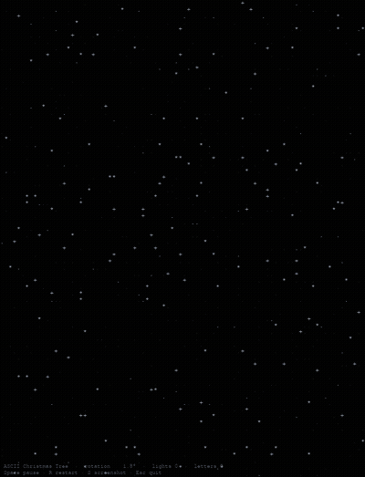

# 🎄 ASCII Christmas Tree

A rotating 3D Christmas tree rendered entirely with ASCII characters, written in Python with **pygame** and **numpy**.

The tree grows from the bottom up. Then the garland, baubles, twinkling lights, gifts and the star appear one after another. Snow falls the whole time, and the message **MERRY CHRISTMAS 2026** types itself out at the end.

<p align="center">
  
</p>

## Features

- **Real 3D scene**: about 76,000 points rotate around the tree's axis with perspective projection
- **Z-buffer per character cell**, so the front of the tree hides the back
- **Lambert shading**: brightness picks a character from a per-object ramp (`.:-=+*xvXW&%#`)
- **Animated timeline**: growth → garland → baubles → lights → gifts → star → message
- **Twinkling lights**, a star that flashes and sends out rays, and falling snow
- **Fast rendering**: all glyphs are pre-rendered into an atlas and the whole frame is composed with numpy in one step (~30 FPS)

## Requirements

- Python 3.9+
- pygame
- numpy

## Installation

```bash
git clone https://github.com/NichaKC/ascii-christmas-tree.git
cd ascii-christmas-tree
pip install -r requirements.txt
```

## Usage

```bash
python christmas_tree.py
```

The animation opens in its own pygame window (it does not draw in the terminal).

| Key     | Action                         |
|---------|--------------------------------|
| `Space` | Pause / resume                 |
| `R`     | Restart the animation          |
| `S`     | Save a screenshot (`tree_<timestamp>.png`) |
| `Esc`   | Quit                           |

## Customization

All settings are constants at the top of `christmas_tree.py`:

| Constant | What it controls |
|----------|------------------|
| `MESSAGE` | The text shown at the end |
| `COLS`, `ROWS` | Grid size in character cells |
| `CW`, `CH`, `FONT_PX` | Cell size and font size in pixels |
| `SPIN` | Rotation speed (rad/s) |
| `T_GROW`, `T_GARLAND`, `T_BALLS`, `T_LIGHTS`, `T_GIFTS`, `T_STAR`, `T_MSG` | When each stage starts (seconds) |
| `RAMPS` | Characters used for each object type, dark → bright |
| `GREEN`, `RED`, `GOLD`, ... | Colours (RGB, 0–1) |

## How it works

1. **Build the scene** (`build()`): every part of the tree is a cloud of 3D points. Each point has a position, a normal, a colour, a kind and the time it appears. Branches are drooping whorls, the garland is a spiral, baubles are Fibonacci spheres, and gifts are boxes with ribbons.
2. **Project**: each frame, the points are rotated around the Y axis and projected to pixel coordinates, which are then mapped to character cells.
3. **Z-buffer**: points are sorted by cell and depth, and only the nearest point in each cell is kept.
4. **Shade**: the brightness from Lambert lighting, plus twinkle and depth fade, chooses a character from that object's ramp and scales its colour.
5. **Compose**: the character grid is turned into an image by multiplying the pre-rendered glyph masks by the cell colours with numpy, then blitted to the window in one call.

## Project structure

```
.
├── christmas_tree.py   # the whole program
├── requirements.txt
├── assets/
│   ├── demo.gif
│   └── screenshot.png
└── README.md
```

## Credits

Inspired by an "ASCII Christmas Tree" reel by [@dwcminh.ascii](https://www.instagram.com/dwcminh.ascii/).
